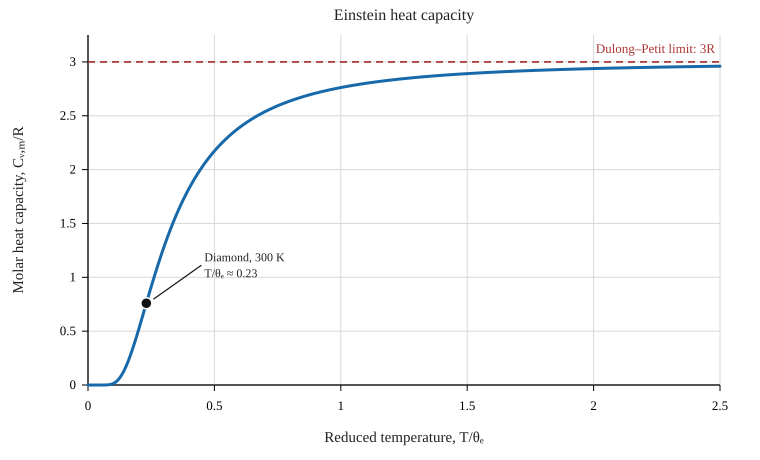

# Einstein Model of a Solid

## 1. Physical model and assumptions

A crystalline solid contains atoms that vibrate about equilibrium positions. The Einstein model approximates these vibrations by treating every atom as three independent quantum harmonic oscillators, one for each spatial direction. For a solid with $N$ atoms, there are therefore $3N$ oscillators.

The model assumes that all oscillators have the same angular frequency $\omega$, and that interactions between vibrational modes can be neglected. It is a simple quantum model of lattice vibrations: unlike the classical equipartition treatment, it accounts for the discrete energy levels of each oscillator.

For one quantum harmonic oscillator, the allowed energies are

$$
\varepsilon_n=\hbar\omega\left(n+\frac12\right),
\qquad n=0,1,2,\ldots,
$$

where $\hbar$ is the reduced Planck constant. The term $\hbar\omega/2$ is the zero-point energy.

We will use the canonical ensemble to derive the partition function, internal energy, and constant-volume heat capacity.

## 2. Partition function of one oscillator

Let

$$
\beta=\frac{1}{k_B T}.
$$

The canonical partition function for one oscillator is the sum of Boltzmann weights over all its energy levels:

$$
z=\sum_{n=0}^{\infty}e^{-\beta\varepsilon_n}
=\sum_{n=0}^{\infty}e^{-\beta\hbar\omega(n+1/2)}.
$$

Factor out the zero-point contribution:

$$
z=e^{-\beta\hbar\omega/2}
\sum_{n=0}^{\infty}\left(e^{-\beta\hbar\omega}\right)^n.
$$

The remaining sum is a geometric series, $\sum_{n=0}^{\infty}r^n=1/(1-r)$ for $|r|<1$. Thus

$$
z=\frac{e^{-\beta\hbar\omega/2}}
{1-e^{-\beta\hbar\omega}}
=\frac{1}{2\sinh(\beta\hbar\omega/2)}.
$$

It is often convenient to define the dimensionless variable

$$
x=\beta\hbar\omega=\frac{\hbar\omega}{k_B T}.
$$

Then $z=e^{-x/2}/(1-e^{-x})$.

## 3. Partition function of the solid

Under the Einstein model, the $3N$ oscillators are independent and identical. Their partition functions therefore multiply:

$$
Z=z^{3N}.
$$

Taking the logarithm,

$$
\ln Z=3N\ln z
=3N\left[-\frac{x}{2}-\ln(1-e^{-x})\right].
$$

This factorization is the key simplification: once the one-oscillator partition function is known, the thermodynamics of the whole solid follows.

## 4. Internal energy

In the canonical ensemble, the mean internal energy is

$$
U=-\left(\frac{\partial\ln Z}{\partial\beta}\right)_{N,V}.
$$

Using $x=\beta\hbar\omega$, with $\omega$ fixed in this model, gives

$$
U=3N\hbar\omega
\left[\frac12+\frac{1}{e^x-1}\right].
$$

Equivalently,

$$
\boxed{
U=3N\hbar\omega\left[
\frac12+\frac{1}{e^{\hbar\omega/(k_B T)}-1}
\right].
}
$$

There are two contributions:

- **Zero-point energy:** $U_0=\frac32N\hbar\omega$, which remains even as $T\to0$.
- **Thermal vibrational energy:** $U_{\mathrm{th}}=3N\hbar\omega/(e^x-1)$, which comes from thermally populated excited levels.

The zero-point term is independent of temperature, so it does not contribute to the heat capacity.

The factor
\[
\bar n(x)=\frac{1}{e^x-1}
\]
is the **Bose–Einstein mean occupation** for a bosonic mode with zero chemical potential. It is the same occupation factor used for photons in the blackbody-radiation discussion and derived more generally in [Bose–Einstein Statistics](bose_einstein_statistics_derivation.md) and [Blackbody Radiation and Planck's Law](blackbody_radiation_planck_law.md). The physical quanta here are lattice vibrations (phonons), not photons; the shared factor arises because each harmonic mode has bosonic excitation levels. Einstein's 1907 model was an early application of quantum ideas to the heat capacity of solids, with all vibrational modes approximated by one frequency.

## 5. Heat capacity at constant volume

The constant-volume heat capacity is

$$
C_V=\left(\frac{\partial U}{\partial T}\right)_V.
$$

Differentiating the internal energy yields

$$
\boxed{
C_V=3Nk_B\,x^2\frac{e^x}{(e^x-1)^2},
\qquad x=\frac{\hbar\omega}{k_B T}.
}
$$

Define the **Einstein temperature**

$$
\theta_E=\frac{\hbar\omega}{k_B}.
$$

It sets the temperature scale associated with the oscillator level spacing. In terms of $\theta_E$,

$$
\boxed{
C_V=3Nk_B
\left(\frac{\theta_E}{T}\right)^2
\frac{e^{\theta_E/T}}
{\left(e^{\theta_E/T}-1\right)^2}.
}
$$

For one mole of a solid, $Nk_B$ is replaced by the gas constant $R$, so the formula becomes $C_{V,m}=3R(\theta_E/T)^2e^{\theta_E/T}/(e^{\theta_E/T}-1)^2$.

## 6. High-temperature limit: Dulong–Petit law

At high temperature, $T\gg\theta_E$, so $x\ll1$. Expanding the exponential,

$$
e^x-1\simeq x.
$$

The heat capacity then approaches

$$
C_V\simeq 3Nk_B\,x^2\frac{1}{x^2}
=\boxed{3Nk_B}.
$$

For one mole,

$$
\boxed{C_{V,m}\longrightarrow 3R.}
$$

This is the **Dulong–Petit law**, which is the classical equipartition result for a harmonic solid. There are $3N$ oscillators, one for each of the three displacement directions of each atom. Each harmonic oscillator has one quadratic kinetic-energy term and one quadratic potential-energy term; equipartition assigns $\tfrac12 k_BT$ to each, for a total mean energy $k_BT$ per oscillator. Hence $U\simeq(3N)k_BT$ and $C_V\simeq3Nk_B$, or $C_{V,m}\simeq3R$ for one mole. At high temperature, the spacing between adjacent quantum levels is small compared with $k_BT$, so many levels are thermally populated and the classical result is recovered.

### Heat-capacity curve and the diamond example

The dimensionless curve is universal in the Einstein model when heat capacity is measured in units of $R$ and temperature in units of $\theta_E$:

For diamond, an Einstein temperature of order $10^3\,\mathrm K$ (a representative value is about $1.3\times10^3\,\mathrm K$) is much higher than room temperature. At $T\simeq300\,\mathrm K$, this gives $T/\theta_E\simeq0.23$, where the Einstein curve is still well below $3R$. The model therefore explains qualitatively why diamond's heat capacity at room temperature is far below the Dulong–Petit limit. The precise heat capacity of diamond is better described by a spectrum of vibrational modes, as in the [Debye model](debye_model_of_a_solid.md).

## 7. Low-temperature limit: quantum freezing out of vibrations

At low temperature, $T\ll\theta_E$, so $x\gg1$. Since $e^x-1\simeq e^x$,

$$
\frac{e^x}{(e^x-1)^2}\simeq e^{-x}.
$$

Therefore

$$
\boxed{
C_V\simeq 3Nk_B
\left(\frac{\theta_E}{T}\right)^2e^{-\theta_E/T}.
}
$$

The heat capacity tends to zero exponentially. When thermal energy is much smaller than the vibrational level spacing, the oscillators rarely occupy excited states; increasing the temperature slightly produces little additional vibrational energy.

This is a major improvement over the classical prediction $C_V=3Nk_B$, which incorrectly remains constant down to arbitrarily low temperatures.

## 8. What the Einstein model gets right—and misses

The Einstein model explains why the heat capacity of a solid falls below the Dulong–Petit value at low temperatures: quantum energy quantization suppresses thermal excitation of vibrations. It also gives a useful interpolation between the low- and high-temperature limits.

Its main limitation is the assumption that every vibrational mode has the same frequency. Real crystals have a spectrum of vibrational frequencies, including low-frequency collective modes. The Einstein model therefore predicts an exponential low-temperature heat capacity, whereas many crystalline solids exhibit a $T^3$ law at sufficiently low temperature.

The **[Debye model](debye_model_of_a_solid.md)** improves on this by treating vibrations as a spectrum of modes with a distribution of frequencies. Its low-frequency modes produce the observed $C_V\propto T^3$ behaviour for an ordinary three-dimensional insulating crystal at low temperature.

In a metal, the total low-temperature heat capacity can also contain an **electronic contribution proportional to $T$**, in addition to the lattice contribution. This linear term comes from fermions near the Fermi energy and is discussed in [Fermi–Dirac Statistics](fermi_dirac_statistics_derivation.md). It is distinct from the Einstein phonon contribution, which is exponentially suppressed at sufficiently low temperature.

## 9. Summary of the derivation

For $3N$ independent oscillators with frequency $\omega$, the canonical partition function is

$$
z=\frac{e^{-\beta\hbar\omega/2}}{1-e^{-\beta\hbar\omega}},
\qquad Z=z^{3N}.
$$

From it, the internal energy and heat capacity are

$$
U=3N\hbar\omega\left[
\frac12+\frac{1}{e^{\hbar\omega/(k_B T)}-1}
\right],
$$

$$
C_V=3Nk_B
\left(\frac{\theta_E}{T}\right)^2
\frac{e^{\theta_E/T}}{(e^{\theta_E/T}-1)^2}.
$$

The limiting behaviour is

$$
C_V\to 3Nk_B\quad (T\gg\theta_E),
\qquad
C_V\to0\quad (T\ll\theta_E).
$$

Thus, the temperature dependence of a solid's heat capacity emerges from the quantized vibrational energy levels.

## Review questions

1. Why are there $3N$ oscillators in the Einstein model of a three-dimensional solid?
2. Derive the one-oscillator partition function from the quantized energy levels.
3. Which part of the internal energy is called zero-point energy, and why does it not contribute to $C_V$?
4. Show that the high-temperature limit gives the Dulong–Petit law.
5. Explain physically why the heat capacity tends to zero at low temperature.
6. Why does the Einstein model predict the wrong low-temperature power law, and how does the Debye model improve it?

---

*This is an original supplementary chapter written for this repository. The Einstein model is an idealized description of lattice vibrations; real solids may require a distribution of phonon frequencies and additional physical effects.*
