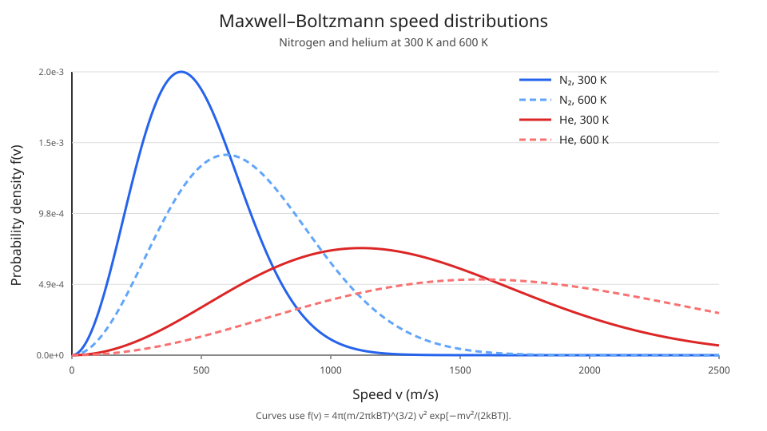

# Maxwell–Boltzmann Speed Distribution

## 1. Physical question

A gas at equilibrium has a well-defined temperature, but its molecules do not all move at the same speed. Why is there a distribution of speeds, and how does temperature determine its shape?

This chapter derives the distribution of molecular speeds for a dilute, classical ideal gas in thermal equilibrium. It complements [Maxwell–Boltzmann Statistics](maxwell_boltzmann_statistics.md), which describes occupations of energy states. The canonical Boltzmann factor applies to a single molecule's microstate, giving a velocity-space Gaussian for its kinetic energy $E=mv^2/2$.

## 2. Microscopic model

Consider a molecule of mass $m$ whose translational kinetic energy is

$$
E=\frac{1}{2}m(v_x^2+v_y^2+v_z^2).
$$

In the canonical ensemble, the probability density in velocity space is proportional to the Boltzmann factor $e^{-\beta E}$, where $\beta=1/(k_BT)$. Normalizing the three independent velocity components gives

$$
p(v_x,v_y,v_z)=
\left(\frac{m}{2\pi k_BT}\right)^{3/2}
\exp\left[-\frac{m(v_x^2+v_y^2+v_z^2)}{2k_BT}\right].
$$

This is a probability density per unit volume in velocity space. The components are independent Gaussian random variables, each with mean zero and variance $k_BT/m$.

## 3. From velocity to speed

The speed is $v=\sqrt{v_x^2+v_y^2+v_z^2}$, so it is nonnegative. All velocity vectors whose endpoints lie between radii $v$ and $v+dv$ occupy a spherical shell in velocity space with volume $4\pi v^2\,dv$.

Because the velocity density depends only on $v$, the probability that the speed lies in this interval is the density at radius $v$ multiplied by the shell volume:

$$
f(v)\,dv=4\pi v^2p(v)\,dv.
$$

Therefore the Maxwell–Boltzmann speed distribution is

$$
\boxed{
f(v)=4\pi\left(\frac{m}{2\pi k_BT}\right)^{3/2}
v^2e^{-mv^2/(2k_BT)},\qquad v\geq0.
}
$$

The factor $v^2$ is essential: even though the probability density of each velocity component is largest at zero, there are many more velocity-space directions in a shell at a larger radius. The exponential eventually wins, so the speed distribution rises from zero, reaches a maximum, and then decays.

The distribution is normalized:

$$
\int_0^\infty f(v)\,dv=1.
$$

Thus $f(v)\,dv$ is the fraction of molecules with speeds between $v$ and $v+dv$. The density $f(v)$ itself has units of inverse speed.

## 4. Characteristic speeds

Different averages answer different questions.

### Most probable speed

The most probable speed maximizes $f(v)$. Differentiating its logarithm for $v>0$,

$$
\frac{d}{dv}\ln f(v)=\frac{2}{v}-\frac{mv}{k_BT}=0,
$$

so

$$
\boxed{v_{\mathrm{mp}}=\sqrt{\frac{2k_BT}{m}}.}
$$

### Mean speed

The mean is obtained by integrating the speed against its probability density:

$$
\langle v\rangle=\int_0^\infty vf(v)\,dv.
$$

Set $a=m/(2k_BT)$. Then

$
\begin{aligned}
\langle v\rangle
&=4\pi\left(\frac{m}{2\pi k_BT}\right)^{3/2}
\int_0^\infty v^3e^{-av^2}\,dv,\\
\int_0^\infty v^3e^{-av^2}\,dv&=\frac{1}{2a^2}.
\end{aligned}
$

Therefore

$
\boxed{\langle v\rangle=\sqrt{\frac{8k_BT}{\pi m}}.}
$

### Root-mean-square speed

The root-mean-square speed is $\sqrt{\langle v^2\rangle}$. From the component variances in Section 2, each of $v_x,v_y,v_z$ has variance $k_BT/m$, so $\langle v^2\rangle=3k_BT/m$. Therefore

$$
\boxed{v_{\mathrm{rms}}=\sqrt{\frac{3k_BT}{m}}.}
$$

These are not interchangeable quantities. Their ratios are universal:

$
v_{\mathrm{mp}}:\langle v\rangle:v_{\mathrm{rms}}
=1:\sqrt{4/\pi}:\sqrt{3/2}\simeq1:1.128:1.225.
$

At $T=300\,\mathrm K$, approximate characteristic speeds are:

| Gas | $v_{\rm mp}$ (m/s) | $\langle v\rangle$ (m/s) | $v_{\rm rms}$ (m/s) |
|---|---:|---:|---:|
| $\mathrm{N_2}$ | 422 | 476 | 517 |
| He | 1116 | 1260 | 1367 |

The mode depends on the variable whose density is plotted. Maximizing $f(v)$ gives the most probable speed; maximizing the energy density gives the most probable kinetic energy. These need not refer to the same molecules because changing variables introduces a Jacobian.

## 5. Kinetic-energy distribution and high-speed tail

Transform from speed to kinetic energy $E=mv^2/2$, using $dv/dE=1/(mv)$:

$
P(E)=f(v)\left|\frac{dv}{dE}\right|
=\frac{2}{\sqrt{\pi}}\frac{\sqrt E}{(k_BT)^{3/2}}e^{-E/(k_BT)},\qquad E\geq0.
$

Thus $P(E)\propto\sqrt E e^{-E/(k_BT)}$: the square-root factor is the three-dimensional density of states and the exponential is the single-molecule Boltzmann weight.

The high-speed tail matters even when only a small fraction of molecules occupy it. Reactions can be dominated by molecules energetic enough to cross an activation barrier, while light molecules in the tail are more likely to escape a planet's atmosphere. A modest temperature increase can substantially change reaction and atmospheric escape rates.

## 6. Temperature and molecular mass

All three characteristic speeds scale as $\sqrt{T/m}$. Raising the temperature broadens the distribution and shifts it towards higher speeds. At the same temperature, lighter molecules have higher characteristic speeds than heavier molecules.

If the horizontal axis is rescaled by the thermal speed $\sqrt{k_BT/m}$, the distribution has the same dimensionless shape for every ideal classical gas. The mass and temperature set the speed scale, not the shape in rescaled coordinates.

## 7. Assumptions and limits

The derivation assumes a dilute classical gas in thermal equilibrium, with nonrelativistic translational kinetic energy. Quantum degeneracy becomes important when the phase-space density is high; strong interactions can also change the simple ideal-gas description. The distribution describes equilibrium speeds, not the time-dependent relaxation towards equilibrium.

## Summary

The canonical Boltzmann factor gives a Gaussian distribution for each velocity component. Counting the spherical shell of velocity states introduces the $4\pi v^2$ factor and produces the Maxwell–Boltzmann speed distribution. Its characteristic speeds scale as $\sqrt{k_BT/m}$, connecting microscopic motion directly to temperature and molecular mass.

## Review questions

1. Why is each velocity component Gaussian in the canonical ensemble?
2. Why does the speed distribution contain a factor $v^2$?
3. Derive the most probable speed by maximizing $f(v)$.
4. Use equipartition to derive the root-mean-square speed.
5. How would the speed distribution change if the molecular mass doubled at fixed temperature?
6. Explain why the most probable, mean, and root-mean-square speeds are different.\n7. Why can the most probable speed differ from the speed associated with the most probable kinetic energy?
