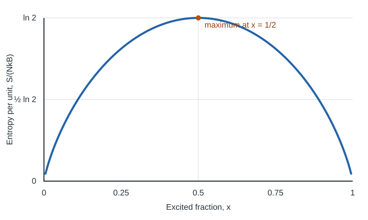

# Temperature

Temperature is often introduced as a thermometer reading or as a measure of how hot something feels. Statistical mechanics gives a deeper definition: **temperature describes how entropy changes when energy is added to a system**. Entropy is determined by the microscopic states compatible with the system's macroscopic constraints, so temperature emerges from the way those possibilities change with energy.

This original supplementary chapter develops that idea using microstates, entropy, energy exchange, and the canonical ensemble. It is not a transcript of any particular lecture.

## 1. Microstates, macrostates, and multiplicity

A **microstate** specifies a system's microscopic configuration at the level of detail used by a model. A **macrostate** specifies coarser properties—such as energy, volume, or particle number—and can be realized by many microstates.

There are two related but distinct ways to count states as a function of energy. They should not be denoted by the same symbol without explanation.

1. The **density of states** $\rho(E)$ counts states per unit energy. For a discrete spectrum, define an energy window of width $\Delta E$ and count states in that window. In a smooth approximation,
   $
   \Omega_{\Delta E}(E)\simeq \rho(E)\,\Delta E.
   $
   The shell multiplicity $\Omega_{\Delta E}$ is dimensionless; $\rho$ has units of inverse energy. Its value depends on the chosen shell width, although an energy-independent choice of $\Delta E$ adds only a constant to the entropy and does not change its energy derivative.
2. The **cumulative phase-space volume** $\Phi(E)$ counts states with energy not exceeding $E$. In a classical system it is the phase-space volume inside the energy surface, divided by the phase-space cell $h^{3N}$ (and by $N!$ for identical particles, when appropriate), so that the count is dimensionless. For a smooth spectrum, $\rho(E)=d\Phi/dE$.

For an isolated system with a specified narrow energy shell, the shell multiplicity is the direct count of accessible states in that shell. A macrostate with greater shell multiplicity is more probable because more microscopic arrangements realize it. The cumulative count is another useful entropy convention, but it includes all lower-energy states rather than only states near the specified energy.

## 2. Entropy counts microscopic possibilities

For a specified energy shell, the **Boltzmann shell entropy** is

$
S_B(E;\Delta E)=k_B\ln\Omega_{\Delta E}(E)
\simeq k_B\ln[\rho(E)\Delta E].
$

For the cumulative count, the **Gibbs volume entropy** is

$
S_G(E)=k_B\ln\Phi(E).
$

The two entropies are not identical for finite systems. They generally agree in their leading thermodynamic-limit behavior for ordinary systems with a smooth, rapidly growing density of states, but their derivatives can differ by relative corrections of order $1/N$. For a fixed energy-independent shell width, changing $\Delta E$ shifts $S_B$ by a constant and leaves its temperature unchanged; choosing a width that itself depends on energy would add an extra derivative term and must be stated.

More generally, for a specified probability distribution over microstates, the Gibbs/Shannon entropy is

$
S=-k_B\sum_i p_i\ln p_i.
$

For a uniform distribution over the states in a shell, this reduces to $k_B\ln\Omega_{\Delta E}$. It does not automatically reduce to $k_B\ln\Phi(E)$, because the latter counts all states below the energy rather than the states in the shell.

Temperature depends not on the absolute size of entropy, but on **how entropy changes with energy**.

## 3. The statistical definition of temperature

For a system whose entropy can be expressed as $S(E)$, define temperature by

$$
\boxed{\frac{1}{T} \equiv \left(\frac{\partial S}{\partial E}\right)_{V,N,\ldots}}.
$$

Equivalently, $T$ is the reciprocal of the entropy-versus-energy slope. The derivative is taken while holding the other relevant constraints fixed. For a discrete system, it can be understood as an appropriate finite difference, or as a smooth approximation for a sufficiently large system.

With the shell convention, the Boltzmann temperature is

$
\frac{1}{T_B}
=\left(\frac{\partial S_B}{\partial E}\right)_{V,N}
=k_B\frac{\partial\ln\rho(E)}{\partial E},
$

where $\Delta E$ is held fixed. With the cumulative convention, the Gibbs temperature is

$
\frac{1}{T_G}
=\left(\frac{\partial S_G}{\partial E}\right)_{V,N}
=k_B\frac{\rho(E)}{\Phi(E)}.
$

These are different finite-system definitions. When the density of states rises steeply with energy, the cumulative integral is dominated by its upper endpoint and the two slopes approach one another. The appropriate convention must therefore be named whenever finite-size corrections or bounded spectra are discussed.

Temperature is therefore determined by the fractional growth of multiplicity per unit energy, not by the total number of states alone.

For ordinary positive-temperature systems, the chosen entropy increases with energy. A steeper entropy curve means a lower temperature, because less additional energy is needed to produce a given entropy change. A shallower slope means a higher temperature. For a bounded spectrum, the Boltzmann shell entropy can reach a maximum and then decrease; its derivative then defines negative Boltzmann temperatures above the entropy maximum. By contrast, the cumulative volume $\Phi(E)$ is nondecreasing by construction, so $S_G=k_B\ln\Phi$ does not acquire a negative slope and does not assign negative temperatures in this way. Thus the negative-temperature criterion is convention-dependent; the physical population inversion and the allowed energy exchanges must be specified, not inferred from the word entropy alone.

### A familiar example: the ideal gas

For a classical monatomic ideal gas, the cumulative phase-space volume scales as $\Phi(E)\propto E^{3N/2}$ at fixed $V,N$. Differentiating gives $\rho(E)\propto E^{3N/2-1}$, so a narrow shell of fixed width has $\Omega_{\Delta E}\propto E^{3N/2-1}\Delta E$. The two entropy conventions therefore give

$
S_G=k_B\ln\Phi
=\text{constant}+\frac{3N}{2}k_B\ln E,
$

and

$
S_B=k_B\ln(\rho\Delta E)
=\text{constant}+\left(\frac{3N}{2}-1\right)k_B\ln E.
$

Their temperatures are

$
\boxed{T_G=\frac{2E}{3Nk_B}},
\qquad
\boxed{T_B=\frac{2E}{(3N-2)k_B}}.
$

Equivalently, $E=(3/2)Nk_BT_G$ and $E=(3N/2-1)k_BT_B$. At the same energy,

$
\frac{T_B}{T_G}
=\frac{3N/2}{3N/2-1}
=1+O(N^{-1}).
$

The difference is a finite-$N$ correction; the familiar ideal-gas relation is recovered in the thermodynamic limit. This example is why the cumulative and shell definitions must be kept distinct even when their leading macroscopic predictions agree.

## 4. Why systems in thermal equilibrium have equal temperatures

Consider two weakly coupled systems $A$ and $B$ that can exchange energy while their total energy remains fixed:

$$
E_A+E_B=E_{\mathrm{tot}}.
$$

If their multiplicities approximately multiply, the multiplicity for a particular energy split is

$$
\Omega_{\mathrm{tot}}(E_A)
=\Omega_A(E_A)\,\Omega_B(E_{\mathrm{tot}}-E_A).
$$

Because entropy is the logarithm of multiplicity, the total entropy is

$$
S_{\mathrm{tot}}=S_A(E_A)+S_B(E_B).
$$

The most probable energy split maximizes this total entropy. Differentiating with respect to $E_A$ at fixed total energy gives the stationary-point condition

$$
\frac{\partial S_{\mathrm{tot}}}{\partial E_A}
=\frac{\partial S_A}{\partial E_A}
-\frac{\partial S_B}{\partial E_B}=0.
$$

Hence,

$$
\left(\frac{\partial S_A}{\partial E_A}\right)
=\left(\frac{\partial S_B}{\partial E_B}\right),
\qquad T_A=T_B,
$$

provided both systems have well-defined temperatures under the same convention.

**Why does the most probable split dominate?** For large systems, the multiplicity is exponentially large in system size, and the probability of an energy split is proportional to $\exp(S_{\mathrm{tot}}/k_B)$. Near a stable entropy maximum, even a modest entropy deficit strongly suppresses a split relative to the peak. The distribution becomes sharply concentrated around the maximizing split; in ordinary macroscopic systems, relative energy fluctuations typically shrink as the system size grows. The peak therefore describes the overwhelmingly likely equilibrium energy sharing, not just an arbitrary stationary point. For a small system, fluctuations can be substantial, and the peak need not describe every instantaneous energy split.

The first-derivative condition gives equal temperatures; stability additionally requires that the stationary point be a maximum of total entropy.

### Which way does heat flow?

Suppose a small amount of energy $\delta Q>0$ leaves system $A$ and enters system $B$. To first order, the total entropy change is

$$
\delta S_{\mathrm{tot}}
= -\frac{\delta Q}{T_A}+\frac{\delta Q}{T_B}
=\delta Q\left(\frac{1}{T_B}-\frac{1}{T_A}\right).
$$

Spontaneous energy transfer proceeds in the direction that increases total entropy. For ordinary positive temperatures, this means net heat flows from the hotter system to the colder one, until their temperatures equalize. More generally, the entropy-slope expression determines the direction even when bounded-energy systems with negative temperatures are considered. This entropy-maximization argument is the central idea in Leonard Susskind's discussion of maximizing entropy in [Lecture 3 notes](../leonard_susskind/statistical_mechanics_lecture_3_notes.md); those notes are a separate, transcript-based study resource, not the source text for this chapter.

## 5. Temperature in the canonical distribution

Now consider a small system in contact with a much larger reservoir. If the small system occupies microstate $i$ with energy $E_i$, the probability of that microstate is proportional to the number of reservoir states compatible with the remaining total energy:

$$
p_i\propto\Omega_R(E_{\mathrm{tot}}-E_i).
$$

Since $S_R=k_B\ln\Omega_R$, expanding the reservoir entropy about its large equilibrium energy gives
$$
S_R(E_{\mathrm{tot}}-E_i)
=S_R(E_{\mathrm{tot}})
-E_i\left(\frac{\partial S_R}{\partial E_R}\right)
+\frac{E_i^2}{2}\left(\frac{\partial^2 S_R}{\partial E_R^2}\right)+\cdots.
$$
Here the reservoir entropy is the entropy associated with its accessible energy shell (or an equivalent smooth thermodynamic entropy in the large-reservoir limit). The expansion assumes the reservoir is much larger than the subsystem, its entropy is differentiable over the exchanged-energy range, and the quadratic and higher terms are negligible. For a discrete spectrum, the shell must contain enough reservoir levels for a smooth approximation to be meaningful. Keeping only the first-order term gives
$$
\ln\Omega_R(E_{\mathrm{tot}}-E_i)
\approx\text{constant}
-\frac{E_i}{k_B}\left(\frac{\partial S_R}{\partial E_R}\right).
$$
Why can the quadratic term usually be neglected? For a macroscopic reservoir, entropy is extensive, $S_R=N_Rs(E_R/N_R)$, so $\partial^2S_R/\partial E_R^2$ scales as $1/N_R$. When the small system's energy remains finite as the reservoir size grows, the quadratic correction vanishes relative to the linear term. The same large-reservoir reasoning underlies the grand-canonical expansion, where first derivatives with respect to energy and particle number produce $1/T$ and $-\mu/T$.

Using $\partial S_R/\partial E_R=1/T$, the probability becomes

$$
p_i\propto e^{-\beta E_i},
\qquad \beta=\frac{1}{k_BT}.
$$

After normalization, this is the canonical distribution:

$$
p_i=\frac{e^{-\beta E_i}}{Z},
\qquad Z=\sum_i e^{-\beta E_i}.
$$

The quantity $Z$ is the **partition function**. Temperature controls how strongly high-energy states are suppressed relative to low-energy states:

- At lower positive temperatures, probability is more concentrated on low-energy states.
- At higher positive temperatures, the distribution over energies is more spread out.
- The relative probabilities of two states depend on their energy difference: $p_i/p_j=e^{-\beta(E_i-E_j)}$.

Thus the microcanonical definition through the entropy slope and the canonical Boltzmann weighting express the same temperature.

## 6. Example: two-level units, negative temperature, and experiment

Imagine $N$ independent units, each with energy either $0$ or $\epsilon$. If exactly $n$ units are excited, then $E=n\epsilon$, and the multiplicity is

$$
\Omega(E)=\binom{N}{n}.
$$

For large $N$, Stirling's approximation gives

$$
S\approx-Nk_B\left[x\ln x+(1-x)\ln(1-x)\right],
\qquad x=\frac{n}{N}=\frac{E}{N\epsilon}.
$$

Differentiating with respect to energy yields

$$
\boxed{\frac{1}{T}=\frac{k_B}{\epsilon}\ln\left(\frac{1-x}{x}\right)}.
$$

*For this model, $S/(Nk_B)=-x\ln x-(1-x)\ln(1-x)$. The slope is positive for $x<1/2$, zero at the entropy maximum, and negative for $x>1/2$.*

The sign change has a direct canonical check. In the canonical ensemble, the probability ratio for an excited unit and a ground-state unit is

$$
\frac{p_{\mathrm{exc}}}{p_{\mathrm{ground}}}
=e^{-\beta\epsilon}.
$$

Since the excited fraction is $x=p_{\mathrm{exc}}/(p_{\mathrm{exc}}+p_{\mathrm{ground}})$, it follows that

$$
\frac{x}{1-x}=e^{-\beta\epsilon}
\quad\Longrightarrow\quad
\beta=\frac{1}{\epsilon}\ln\left(\frac{1-x}{x}\right).
$$

Using $\beta=1/(k_BT)$ reproduces exactly the entropy-derivative result above. For $x<1/2$, ground states are more populated and $T>0$. At $x=1/2$, the populations are equal, the entropy is maximal, and $\beta=0$ (the infinite-temperature limit). For $x>1/2$, the excited states are more populated and $T<0$.

Negative temperatures are not colder than absolute zero. For systems that support them, they lie beyond the infinite-temperature limit in the thermodynamic ordering: energy tends to flow from a negative-temperature system to a positive-temperature system when they are brought into weak thermal contact. The crucial restriction is that the relevant degrees of freedom have a bounded energy spectrum and can reach the inverted population distribution.

This is not only a mathematical possibility. In their 1951 paper, [E. M. Purcell and R. V. Pound reported a nuclear spin system at negative temperature](https://doi.org/10.1103/PhysRev.81.279). Their experiment used nuclear spins in a lithium fluoride crystal; a rapid manipulation of the magnetic field produced an inverted spin polarization, which was detected through nuclear magnetic resonance. The spin system later relaxed back toward ordinary thermal equilibrium. This is a classic experimental realization of negative spin temperature, not a claim that the entire crystal lattice was at a negative temperature.

## 7. What temperature is—and is not

From the statistical-mechanical viewpoint:

1. **Temperature is not total energy.** Systems with different sizes and energies can have the same temperature.
2. **Temperature is not entropy itself.** It is related to the derivative of entropy with respect to energy under specified constraints.
3. **Temperature is not fundamentally a sensation.** It is a parameter inferred from microscopic state counts or equilibrium probabilities.
4. **Temperature is an equilibrium parameter.** For weakly coupled systems in stable thermal equilibrium, their entropy slopes are equal.
5. **Temperature depends on the model and constraints.** A calculation requires specifying the available states and which macroscopic quantities are held fixed.

For small systems, energy fluctuations can be appreciable, so one should be careful about treating temperature as a perfectly sharp descriptor. Away from equilibrium, a single temperature may not be defined without additional assumptions. The entropy-derivative definition is fundamentally an equilibrium one.

## 8. A practical method for calculating temperature

For a new model:

1. Specify the microstates and constraints.
2. Count accessible states at each energy, or calculate the relevant probability distribution.
3. Obtain the entropy, for example $S(E)=k_B\ln\Omega(E)$ for a uniform microcanonical description.
4. Differentiate with respect to energy while holding the other specified constraints fixed.
5. Apply $T=[(\partial S/\partial E)_{V,N,\ldots}]^{-1}$, checking the sign and the range in which the approximation is valid. If the entropy slope is zero, temperature diverges; do not assign a finite value by simply substituting zero into the reciprocal.

If using the canonical ensemble, calculate the partition function and use $\beta=1/(k_BT)$. The microcanonical and canonical approaches give consistent descriptions of temperature in appropriate equilibrium and large-system limits, though finite systems and phase transitions require care.

## Summary

Temperature is the reciprocal of the entropy slope with energy,

$$
\boxed{T=\left[\left(\frac{\partial S}{\partial E}\right)_{V,N,\ldots}\right]^{-1}},
\qquad
\boxed{\beta=\frac{1}{k_BT}}.
$$

For ordinary systems such as an ideal gas, this definition gives familiar positive temperatures and relations such as $E=\frac{3}{2}Nk_BT$. Equilibrium energy sharing is governed by the maximum of total entropy, which is sharply peaked for large systems; the condition for its maximum is equality of temperatures. In systems with bounded energy, the entropy can decrease at high excitation, allowing negative-temperature states. The two-level model illustrates this sign change, and its entropy-slope formula agrees with the canonical Boltzmann factor.

## Review questions

1. Why is multiplicity relevant to the probability of a macrostate in an isolated system?
2. Why is temperature related to the derivative of entropy rather than to entropy itself?
3. Derive $T_A=T_B$ by maximizing the combined entropy of two systems at fixed total energy.
4. Explain why the most probable energy split dominates for large systems, and derive the direction of spontaneous heat flow.
5. How does $\beta$ appear in the canonical probability distribution?
6. Show that the two-level entropy derivative agrees with the canonical Boltzmann factor.
7. Why does the temperature of the two-level model become infinite at half excitation and negative above half excitation?
8. What did the Purcell–Pound experiment demonstrate, and why is a bounded energy spectrum important?

---

*This is an original supplementary chapter written for this repository. It is not a transcript of, or a claim about the contents of, any particular lecture. Check conventions and derivations against a standard statistical-mechanics text when using it for formal study.*
